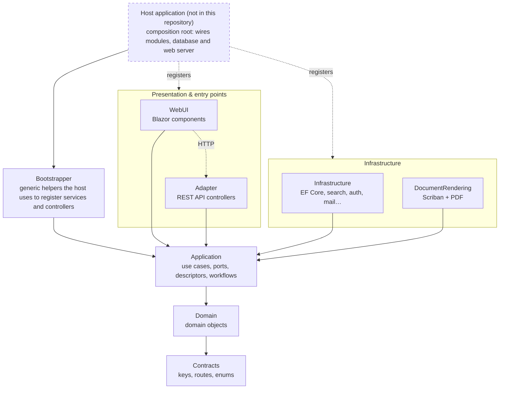

# BusinessAppFramework

**A .NET 10 framework for building line-of-business web applications.**

BusinessAppFramework gives you the plumbing every back-office application needs, so that a business module only has to describe *what* it manages, not *how* it is stored, searched, displayed or exported.

Out of the box it provides:

- **Domain objects** with identity, audit trail, references between objects and parent/child hierarchies.
- **Persistence** on SQL Server or SQLite through Entity Framework Core, with a clean separation between domain objects and database entities.
- **Search** with pagination, sorting and named constraints (filters) for every domain object type.
- **A generic REST API** that exposes create / read / save / delete / search for any registered domain object.
- **A Blazor UI toolkit** (MudBlazor) with ready-made browsers, editors, selectors, dialogs, KPIs and workspaces.
- **Workflows** (steps, transitions, conditions) that drive the state of a business object.
- **Document generation**: HTML templates rendered with Scriban and turned into PDF with a headless Chromium.
- **Cross-cutting services**: authentication (JWT), module and user settings, localization, mail, file storage, image compression, logging.

An application built on the framework is the combination of **framework libraries** (this repository), one or more **business modules** that plug into them, and a **host** that wires everything together. This repository only contains the framework; it ships no executable.

## Architecture at a glance

The solution follows a clean architecture. Dependencies only point inward, towards the domain.

Bootstrapper sits above the layers: it does not belong to any of them and only exposes generic helpers. The host, which lives outside this repository, uses them to wire every module, pick a database context and start the web server.

The WebUI never talks to the Infrastructure layer directly. It calls the REST API exposed by the Adapter through small HTTP gateways, using the routes defined in Contracts.

Read more in [docs/architecture.md](docs/architecture.md).

## Projects

| Project | Layer | Purpose |
| --- | --- | --- |
| [BusinessAppFramework.Contracts](docs/projects/Contracts.md) | Shared | Constants shared by every layer: action keys, error keys, settings keys, API routes, enums. |
| [BusinessAppFramework.Domain](docs/projects/Domain.md) | Domain | The `DomainObject` base class, references between objects, localized texts. |
| [BusinessAppFramework.Application](docs/projects/Application.md) | Application | Use cases and ports: services, repositories and search interfaces, descriptors, application actions, workflows, trees, chains, events, settings. |
| [BusinessAppFramework.Infrastructure](docs/projects/Infrastructure.md) | Infrastructure | Implementations backed by EF Core and third-party libraries: repositories, search, relations, mapping, JWT, logging, mail, storage. |
| [BusinessAppFramework.Adapter](docs/projects/Adapter.md) | Entry point | ASP.NET Core Web API controllers, mostly generic, that expose the application layer over HTTP. |
| [BusinessAppFramework.DocumentRendering](docs/projects/DocumentRendering.md) | Infrastructure | Document templates, model loaders and the HTML-to-PDF renderer. |
| [BusinessAppFramework.Bootstrapper](docs/projects/Bootstrapper.md) | Composition | Generic helpers the host uses to register services and closed generic controllers when it boots the modules. |
| [BusinessAppFramework.WebUI](docs/projects/WebUI.md) | Presentation | Blazor component library and the HTTP gateways that call the API. |

## Key concepts

A few words you will meet everywhere in the code:

- **Domain object**: a business entity handled by the framework (a customer, an order, a task…). It derives from `DomainObject`, which gives it an id and audit fields.
- **Module**: a package of business features that registers its domain objects, services, UI descriptors, workflows and constraints through an `IModuleBootstrapper`.
- **Workspace**: a screen of the application. A workspace descriptor says which Blazor component renders it. The most common one is the **domain object browser**, a searchable list of one domain object type.
- **Application action**: a declarative description of something the user can trigger (create, delete, navigate, download, open a dialog). The UI renders it as a button, the backend executes it.
- **Constraint**: a named filter applied to a search, exposed in the UI as a chip the user can toggle.
- **Relation**: a typed link between domain objects. References point to one object, reference lists to many, parent/child relations build trees.
- **Workflow**: an ordered set of steps with transitions and conditions that move a domain object through a business process.

## Tech stack

.NET 10, ASP.NET Core, Blazor with MudBlazor, Entity Framework Core (SQL Server and SQLite), AutoMapper, Serilog, Scriban, PuppeteerSharp, Magick.NET.

## License

MIT, see [LICENSE](LICENSE).
