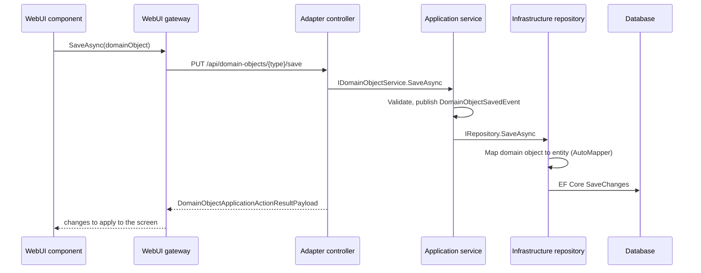

# Architecture

BusinessAppFramework follows the **clean architecture** principles: the business rules sit at the center, technical concerns sit at the edges, and every dependency points inward. A layer never knows about the layers outside it.

## Layers

Three projects form the core and carry no technical dependency: Contracts, Domain and Application. The five others sit at the edges and depend on the core: Infrastructure, DocumentRendering, Adapter, Bootstrapper and WebUI. The diagram in the [README](../README.md) shows them side by side.

### Contracts

Constants that every layer, frontend included, needs to agree on: action keys, constraint keys, error and message keys, settings keys, API route segments and a few enums. It depends on nothing. Keeping it apart from Domain means the Blazor frontend can build an API URL or display an error key without pulling in business types.

### Domain

The heart of the model: the `DomainObject` base class, the `DomainObjectReference` and `DomainObjectReferenceList` types used to link objects together, `LocalizedText` for multilingual values, and a handful of marker interfaces (`IIndexable`, `ISystemObject`, `IHasReferenceNumber`). No persistence, no HTTP, no UI.

### Application

The use cases and the **ports**. This is where the framework defines what it can do, as interfaces, and implements the parts that do not depend on a technology:

- `IDomainObjectService<T>` and its default `DomainObjectService<T>`: the CRUD use cases for any domain object, including validation, hydration of references and event publication.
- `IRepository<T>`, `ISearchService<T>`, `IRelationService`, `IAuthenticationService`, `IDocumentGenerator`, `IMailService`, `IFileSystemService`… : ports that the Infrastructure layer implements.
- **Descriptors**: declarative descriptions of UI screens (workspaces, domain object browsers, selectors) that the WebUI renders.
- **Application actions**: declarative descriptions of what a user can trigger.
- **Workflows, trees, domain object chains, KPIs, activities**: business building blocks shared by backend and frontend.
- **Registries and factories**: the plug-in points a module uses to register its types.
- `IModuleBootstrapper`: the contract a business module implements to plug into the framework.

### Infrastructure

The **adapters driven by the application**: everything that touches a database, a file system or a third-party library. Entity Framework Core contexts for SQL Server and SQLite, generic repositories mapping domain objects to entities with AutoMapper, the search service, relation resolution, JWT token generation, password hashing, Serilog logging, mail, printers, image compression and document storage.

### DocumentRendering

A specialised infrastructure project for generating documents. It renders Scriban HTML templates with data loaded from domain objects and converts the result to PDF with PuppeteerSharp.

### Adapter

The **driving adapter** on the server side: ASP.NET Core Web API controllers. Most of them are generic (`DomainObjectController<TDomainObject, TSearchResult>`, `DomainObjectSearchController<…>`) and are closed per domain object type at startup.

### Bootstrapper

The toolbox of the composition root. It is not a layer: it sits above all of them and only exposes generic helpers (registration of closed generic controllers, route conventions, service registration shortcuts). The actual composition root is the host application, outside this repository, which is why Bootstrapper itself only references Application.

### WebUI

The Blazor frontend. A Razor class library built on MudBlazor that renders the descriptors defined in Application and calls the REST API through HTTP gateways. It depends on Application and Domain for the types it displays, but never on Infrastructure.

## How a request flows

A typical round trip, saving a domain object from the UI:

The frontend and the backend share the same Application and Domain assemblies, so a domain object, a descriptor or a workflow is the same type on both sides. What travels over HTTP is JSON produced from those types.

## How a module plugs in

The framework alone does nothing visible. A **business module** brings the actual features and plugs in by implementing `IModuleBootstrapper` (Application) and, for its controllers, `IWebApiModuleBootstrapper` (Adapter). The bootstrapper declares:

- the backend and frontend service assemblies to scan,
- the domain object types and their entity mapping,
- browser and selector descriptors, constraints, icons and components for the UI,
- workflows and their context loaders,
- relations: references, reference lists and parent/child trees,
- navigation actions, domain object chains and settings,
- the workspaces (screens) it contributes.

A host application collects the module bootstrappers, registers everything with the helpers from Bootstrapper, configures a database context and serves both the API and the Blazor UI.

## Design choices worth knowing

- **Domain objects and entities are distinct types.** A domain object is what the business logic and the UI manipulate. An entity is what EF Core persists. AutoMapper profiles, contributed per module, translate between the two. This keeps the domain free of persistence attributes.
- **Generics everywhere.** Services, repositories, search services and controllers are generic over the domain object type. A module rarely writes a controller or a repository; it registers closed generic types.
- **Declarative UI.** Screens are described by descriptors and actions in the Application layer, and rendered by generic Blazor components. A module gets a browser, an editor and a page for a new domain object type mostly by configuration.
- **Keys over types across the wire.** Actions, constraints, workspaces, relations and settings are identified by string keys declared in Contracts, so the frontend and backend can refer to them without sharing implementation types.
